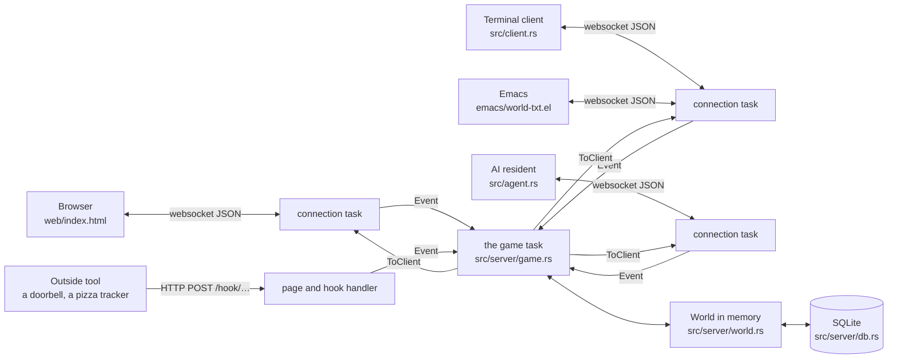

# How it works

A tour of the machinery: how a world runs, how a command becomes words on
someone's screen, and how the noisier features (tunes, rain, gramophones,
radios) make sound. For where each file lives, see
[development.md](development.md); for the exact limits and timings, see
[rules.md](rules.md).

## The big picture

One binary does everything: it's the server, the terminal client, the
resident, and the tool for making invites. A world is that binary plus one
SQLite file.

## One port, two doors

`world.txt serve` listens on a single port (`src/server/mod.rs`). Each
incoming connection is peeked at:

- **A websocket upgrade** becomes a player: a small task is spawned to
  shuttle JSON between the socket and the game.
- **Plain HTTP** gets the browser page (`web/index.html`, compiled into the
  binary with `include_str!`, so there's nothing else to deploy), the world's
  public signing key at `/.well-known/world.txt` (for visiting, below), or a
  hook: an outside tool posting to `/hook/<secret>` to leave a note, fill a
  progress bar or flip a status light on a noticeboard.

## The one task that owns the world

Everything that happens goes through a single task (`game::run`). Connection
tasks don't touch the world. They send it an `Event` (someone joined, typed a
command, sent some music, left), and it answers each player through their
own outgoing queue. Because only one task ever holds the world, there are no
locks and no races: every command sees the world exactly as the last one
left it.

The loop waits on three things at once:

- **Events** from connections and hooks, handled as they come.
- **The tick**, every 3 seconds: the world turning. Weather moves, gardens
  grow, wild animals and island folk wander, the scenery drops the odd line,
  events start, made things do their things.
- **The stride**, every half second: the quick stuff. People walking with
  `join` or `go to`, rowing boats, music and radios being kept in earshot,
  cooking smells, and side panels that are due for a refresh.

The world lives in memory (`World`: tiles, things, homes, plantings,
descriptions) and every change is written straight through to SQLite as it
happens. Starting up just reads it all back. Nothing is lost to a restart,
except things that were only ever meant to be fleeting (a kite in the air, a
game of rock, paper, scissors halfway through).

## A command's journey

Say Poppy types `hum @100 C C G G A A G-`.

1. **The browser** sends `{"type": "cmd", "text": "hum @100 C C G G A A G-"}`.
2. **Her connection task** checks it against a gentle speed limit (a token
   bucket: 20 in a rush, then 4 a second) and passes it on as `Event::Cmd`.
3. **The game** quietly notes the first time she's tried each feature, for
   `discoveries` (just "Poppy has hummed", never what she hummed). Then it
   works out which command this is. Shortcuts first (`'hi`, `:waves`,
   `@Sam`), then walking, then the little families of commands that live in
   their own modules (inside, together, hills, games, folk…), then the big
   `match` in `Game::command`.
4. **The command** does its thing and sends lines back: "You hum ♪ … ♪" to
   Poppy, and "Poppy hums ♪ … ♪" to everyone on her spot who hasn't muted
   her. People a step or two away hear "someone hums nearby".
5. **The connection tasks** turn those into JSON and send them down each
   socket.

## What travels on the wire

The protocol (`src/protocol.rs`) is JSON, tagged by `type`.

**To the world:** `hello` (signing in with an invite, a device token or a
passport), `cmd` (anything typed), `audio` (gramophone music), and `queue` /
`track_done` (jukeboxes).

**From the world:**

- `lines`: text for the scrolling log. A line is a list of spans, each with
  a *named* colour (`cyan`, `sand`, `deep_blue`…) rather than an ANSI code,
  so every client draws them its own way. A span can also be a tap: `run`
  is a command to send when it's tapped, and `fill` is text to put in the
  command box ready to finish (people's names fill `@Sam `). Clients that
  can't tap, like the terminal, just show the words.
- `status`: the side panel. Place, weather, clock, a minimap (itself just
  coloured lines), who's about, any progress bars and status lights, and
  `actions`: what you could do where you're standing, most likely first
  (people and island folk, creatures, things, the ground), each one a command
  to run or to put in the box (`src/server/game/actions.rs`). Only plain,
  practical things you can see; the playful secrets never turn up there. The
  world checks each tick whether yours have changed (a find appearing, an
  animal wandering in), and freshens the panel if so. The browser shows them
  as buttons; the terminal client lists them and Tab steps through them.
- `board`: a noticeboard's notes, for the board view.
- `circle`: a turn of the humming circle where you are (below).
- `hint`: the current first-steps nudge.
- `welcome`, `bye`, `restarting`, `travel`: signing in, being turned away, a
  redeploy in progress, going to another world. `welcome` also carries a
  fingerprint of the page the world serves (it's written into the page too),
  so a browser left open across an update offers to reload.
- `audio`, `audio_end`, `radio`, `spin_start`, `juke_turn`…: sound (below).

Clients are deliberately thin. The world decides what everyone sees, and the
browser and terminal just draw it. Links in text are the only formatting
there is (`src/links.rs`).

## The islands

**The shape.** A world is four islands, each in its own 64×64 patch of sea
(`src/server/islands.rs`): Home Island, Driftwood Isle, Mossy Holm and Ember
Rock. Each one is grown once, from the world's seed, using layered value
noise (`rng::fbm`). One noise field gives height, which falls away towards
the edge of the patch so it ends up an island. A second gives wetness. The
two together pick the terrain: deep water, shallows, sand, grass, meadow,
forest, hills, stone, ponds. The seed is stored, so a world keeps its shape
for ever.

**Things.** Everything people make is a `Thing` at an (x, y): a name, what
it does ("croaks when it rains"), when it does it, who made it, and
sometimes a kind (a noticeboard, a building, a gramophone, a display case)
that gives it extra behaviour.

**Rooms.** Every finished building has a room inside, and rooms live off the
map. A building's room sits at coordinates a million steps away (see
`world::room_for`), placed so the rest of the world still knows which island
and home it belongs to. That means anything that works by "where you're
standing" (talking, making things, display cases, paint) works indoors
without knowing rooms exist. The few things that care (weather, walking,
shouting, music) ask `room_of` and behave accordingly.

**Changing the shape of the data.** Old worlds are brought up to date when
they start. Each one-off fix is guarded by a flag in the `meta` table (such
as `rooms_spread` or `village_green`), so it runs exactly once.

**Backups.** A copy of the world is made every day using SQLite's online
backup, so it's consistent even while people are playing
(`src/server/backup.rs`).

## Time and weather

**The clock.** Island time runs at one game minute per real second, so a day
passes in 24 real minutes (`weather::Clock`). Dawn, day, dusk and night come
round about sixty times a day. Seasons change every Monday, so a whole year
goes by in a month, and each season's Saturday is a festival. All of this is
worked out from the real clock, so it's the same in every world and needs no
saving.

**The weather is local.** Clouds are circles drifting across the
archipelago on a wind that slowly changes direction and speed. New ones
arrive from upwind. How wet it is at any spot depends on the nearest cloud
and how strong it is: past one point it's drizzle, past another it's rain.
So it really can be raining by the river and sunny in the meadow, and you
can watch a shower come towards you. In winter, rain falls as snow. Indoors,
it never rains.

## Living things

Several kinds of thing on the island aren't players:

- **Finds** (`nature.rs`, `gather.rs`): flowers, butterflies, shells,
  mushrooms. They appear near people, depending on the ground, the weather
  and the time, and fade if nobody gathers them.
- **Wild animals** (`companions.rs`): they turn up beside people and wander
  their own kind of ground a step at a time. Befriend one with a berry and
  it becomes your companion.
- **Island folk** (`folk.rs`): scripted characters, one or two to an island.
  Each has a name drawn from a long list and a trade. They row in, potter
  about, keep island hours, make little things that don't last and tidy them
  away, and now and then throw a party, which is a real event on the
  village noticeboard. Who's on which island is saved in `meta` as JSON, so
  a restart doesn't scatter them.
- **Residents** (`src/agent.rs`): AI characters who connect like players.
  See below.

All of them share one rule: **nothing chatters at someone who's stepped
away.** Each player counts the scenery lines they've had since they last
typed anything (`ambient_quiet`). Past a couple, they're treated as away
(`Player::about`), and the scenery, animals and folk go quiet for them until
they're back.

## Sound

The world never makes a sound. It sends words, numbers and web addresses,
and each browser makes its own noise from them. With the sound off, or in
the terminal, everything still reads perfectly well as text.

| What | What travels | What the browser does |
|---|---|---|
| Hums, songs, music boxes, folk whistling | A line containing `♪ … ♪` | Reads the notes and plays them on a little synthesiser |
| Weather and wildlife | Levels from 0 to 1 in the side panel | Makes rain, wind, waves, thunder, birds, crickets and fire from noise and oscillators |
| Gramophones and jukeboxes | Compressed audio, relayed through the world | Decodes it and plays it at a volume for how near you are |
| Radios | A web address and a volume | Streams straight from the station |

### Tunes

Anything inside `♪ … ♪` in a line is played, wherever it came from: a hum, a
music box, a folk whistle. The server barely touches it. A hum goes out
exactly as typed, and a music box's tune is tidied by `music::clean_tune`
when it's taught, so it only ever holds real notes.

In the browser, `parseTune` reads it word by word:

- `@100` sets the tempo, so a beat is 60 ÷ 100 = 0.6 seconds (120 if none
  is given, clamped between 40 and 240).
- A note is a letter, then optionally `#` or `b`, then optionally an octave
  from 2 to 6 (4 if none is given). After that come length marks: each `-`
  adds a beat, each `/` halves the length, and a `.` makes it half as long
  again. `G-` is 2 beats and `D/.` is ¾ of one.
- `_` is a rest, and takes the same length marks.
- Anything else ("happy", "la") is skipped, so ordinary words in a hum
  never play.

Each note becomes a MIDI number (middle C is 60: 12 × (octave + 1) +
semitones from C), and the MIDI number becomes a pitch: 440 Hz ×
2^((n − 69) ÷ 12), so A above middle C is 440 Hz. `playTune` then uses the
Web Audio API. For each note it makes a triangle-wave oscillator (soft and
round, a bit like an ocarina) and a gain node for its volume. The volume
rises in 20ms, holds for about 90% of the note's length, and fades out over
the next tenth of a second or so. That's why long notes sing and short ones
stay crisp. Every note is booked ahead on the audio clock at its exact start
time, so the rhythm holds even if the page is busy.

Everyone at the spot gets the same line and plays it in their own browser,
so it sounds the same for all of them. It isn't exactly in sync, though:
each browser starts when its own copy arrives.

### Humming circles

`hum along` (in `src/server/game/circle.rs`) is for keeping several people
in time. A circle belongs to a spot, and its first tune sets how long a turn
is, in beats, and how fast. Each person's part is a list of sections, one a
turn, that loops.

The world keeps the beat itself: the game loop's `select!` has one more
branch, a sleep until the next turn of whichever circle is due soonest. A
turn's start is worked out from when the circle began (start + turn length ×
turn number), so it doesn't drift. If the world falls behind, it carries on
from now and doesn't rush to catch up. When a turn comes round, each person at the spot gets a `circle` message
with everyone's sections for that turn (minus anyone they've muted), so
however long the trip to their browser takes, the parts arrive and start
together. Network lag shifts the whole circle a little for each listener but
never pulls the parts apart. The browser plays them all and shows who's
humming, and which section of how many, in a strip above the command box,
with a line sweeping across the turn, so the notes never fill the log. The
terminal prints one short line a turn. An empty `circle` means it's over
(or you've walked away); the browser also lets the strip go if no turn comes
for a while.

The world rewrites every section with the circle's tempo before sending it,
and the browser plays it with the same `playTune` as any other tune.
Residents aren't sent the turns, since each one would wake them for nothing.

### Weather and wildlife

None of these sounds come from files. Each side panel carries a `sounds`
set (`src/server/game/sounds.rs`): rain, thunder, wind, waves, birds,
crickets and fire, each from 0 to 1, worked out from where you're standing.

- **Rain** comes from the cloud overhead (snow is silent).
- **Thunder** comes in a proper storm, when the cloud is heavier still.
- **Wind** depends on the wind speed and how exposed you are: full on hills,
  sand and water, less in the woods.
- **Waves** are full right by the sea and fainter two steps back.
- **Birds** sing by day, most in the woods.
- **Crickets** come out at dusk and night, in the grass, but not in winter
  or wet weather.
- **Fire** crackles beside a campfire.

Indoors, the rain drums on the roof at a third of the volume, the wind is
only just there, and the wildlife is shut out. Levels are rounded to
quarters, so a fresh side panel only goes out when you'd actually hear the
difference. The world also checks every tick whether what someone would
hear has changed (a shower arriving, dusk bringing the crickets out), and
sends a new panel when it has.

The browser shares a single two-second buffer of random noise between
everything, and builds two kinds of sound from it:

- **Beds** keep running underneath, each through its own filter and volume.
  Rain is noise through a 1400 Hz low-pass filter, which softens the hiss
  into a patter. Wind goes through a band-pass filter: every few seconds a
  gust picks a new volume and the filter's pitch drifts, so it sighs and
  gusts. Waves go through a low-pass filter that opens as each wave rolls in
  over two or three seconds and closes again as it draws back over four to
  six. A soft low hiss sits under a fire.
- **One-offs** are booked when they're due, about four times a second.
  Thunder is two long, low puffs of noise, the second rolling in just
  after, every 20 to 60 seconds, and never the moment the storm arrives. A
  bird is two to five quick sine-wave notes, each rising in pitch, coming
  more often the more birds there are. A cricket is three tiny pulses at
  about 4.5kHz, every second or so. A fire's crackle is a burst of noise a
  few hundredths of a second long through a band-pass filter at a random
  pitch, several times a second.

Every volume glides rather than jumps, so a shower arrives and leaves
gently, and turning the sound off fades it all out.

### Gramophones

A gramophone plays music from someone's own computer to everyone nearby,
and the world never keeps any of it (`gramophone.rs`):

1. **The player's browser** plays the chosen file through an audio element,
   tapped by a small `AudioWorklet` that hands over the raw sound as it
   plays.
2. That's cut into 20ms frames and compressed with the browser's built-in
   **Opus** encoder (WebCodecs `AudioEncoder`, 48kHz stereo, 96kbps).
3. Every 200ms, the frames gathered so far are sent to the world as base64,
   with the song's title.
4. **The world** passes them on to everyone within 5 steps of the
   gramophone. With each batch it sends a volume for where they're standing:
   1 − steps ÷ 6, so full beside it and faint at the edge of earshot. To
   keep a stalled connection from piling up, it drops music for anyone
   already about five seconds behind.
5. **Each listener's browser** decodes the frames (WebCodecs `AudioDecoder`)
   and schedules them back to back, about 0.4 seconds behind, so small
   wobbles in the network don't leave gaps. The volume glides as people
   walk nearer or further away.

A **jukebox** works the same way, with turns. When people add songs, only
their titles go to the world, and the files stay on their own computers.
When it's someone's turn, the world tells their browser to play that song to
everyone in earshot, exactly like a gramophone.

### Radios

A radio sends no audio through the world at all. The world tells each nearby
browser a station's web address and a volume, and the browser streams it
straight from the station with an ordinary audio element. While someone's
listening, the world sometimes checks what's on: the stream's own title (the
ICY metadata many stations send) or the station's programme guide. That
gets mentioned in words.

## Accounts and privacy

- **Invite-only** (`accounts.rs`). A keeper makes an account and gets a
  one-use magic link. Opening it swaps the link for a device token kept on
  that device, and from then on the token is how they get in. The world only
  stores hashes of links and tokens, never the secrets themselves.
- **Keepers** are the island's caretakers. They can do a few extra things,
  but can't read anyone's conversations. Nothing anyone says to anyone else
  is kept for keepers to read: they only see what people deliberately send
  them (`suggest`, `report`), plus the bare "who's found which feature" from
  `discoveries`.
- **Muting** is by username, and it's checked everywhere a line goes out:
  speech, hums, folk, notes, bottles.

## Visiting other worlds

Each world has a signing key and publishes its public half at
`/.well-known/world.txt` (`federation.rs`). Leaving from a dock, a world
signs a short-lived passport for its traveller and sends their browser to
the other world. That world checks the signature against the home world's
published key, and puts the visitor in a waiting room until a keeper lets
them in (or straight in, if they've been let in before or their world is
trusted).

## Residents

A resident (`src/agent.rs`) is an AI character that connects exactly like a
player, so the world treats it as one, with tighter rules. It only thinks
when something happens near it, and it calls the Claude API (Haiku) with its
character sheet plus the last few lines it saw. Layered limits keep the cost
down: it's asleep when no people are on, there's a minimum gap between
thoughts and a cap on them each hour, and a daily budget is worked out from
the API's own usage numbers. `world.txt bridge` keeps a resident connected
for something else to drive instead, such as a Claude Code session
(`src/bridge.rs`).

## The clients

- **The browser** (`web/index.html`) is one self-contained page: the log,
  the side panel with its minimap, board views, and all the sound above. It
  reconnects on its own after a redeploy and picks up where it left off.
- **The terminal** (`src/client.rs`) is a ratatui app with the same log and
  side panel. Music goes to mpv if it's installed (`src/sound.rs`): a radio's
  stream by its URL, and gramophone frames wrapped in Ogg on mpv's stdin, with
  the volume following you over mpv's control socket. Playing your own songs
  works the other way round (`src/records.rs`): ffmpeg encodes the file in
  real time to Opus in Ogg, and the packets inside go to the world as a
  browser's would. `play music <paths>` and `add songs <paths>` are caught in
  the client, so the world only ever sees `play music`, `add songs` and the
  songs' titles. Hums and the island's own sounds come from a little synth
  (`src/synth.rs`), the browser's own recipe redone in Rust: triangle-wave
  notes, filtered noise for rain, wind and waves, and the one-off chirps,
  crackles and rumbles, written as raw samples to one more mpv that stays
  open, a moment ahead of real time. Sound starts off, as in the browser
  (`sound on` in the client). All of that lives in `src/speakers.rs`, which
  takes what the world says and what's typed, and hands back lines to show
  and messages for the world, so another client can have the same sound.
- **Emacs** (`emacs/world-txt.el`) draws the same log and panel in a buffer
  for each world. Its sound is `world.txt sound`: the same speakers in a
  process of their own, one per world, over stdin and stdout a line at a
  time. Emacs passes it everything the world sends, as it came, and
  everything typed as `typed <text>`. It answers `say <line>` to show and
  `send <json>` for the world, which is how `sound on` and `play music`
  stay on your computer and everything else goes on to the world.

## Running a world

- **Locally:** `world.txt serve`.
- **On your own Mac, always on:** `world.txt service install` sets up launchd agents
  that start the world and a Cloudflare tunnel at login, and restart them if
  they fall over (`src/service.rs`).
- **On Fly.io:** the Dockerfile builds the release binary in a Rust image
  and copies it into a slim Debian one. The world lives on a volume at
  `/data`, and the server runs as an ordinary unprivileged user.
  `deploy/fly-deploy all` deploys every world in turn, and `deploy/fly-backups`
  copies their daily backups down off Fly. A redeploy tells
  every browser `restarting`, they reconnect a few seconds later, and nobody
  loses their place.

## Keeping it healthy

Small limits stop one slow phone or a runaway script from making trouble
for everyone else (`src/server/mod.rs`):

- Commands have a speed limit per connection: 20 in a rush, then 4 a second.
- Each connection's outgoing queue is watched. Past 50 waiting messages, side
  panel updates are skipped (a fresh one follows soon anyway). Past 500, the
  connection is closed and the browser reconnects from scratch.
- Music more than about five seconds behind is dropped rather than queued.
- A single message is capped at 512KB, or 8KB before someone has signed in.

---
[← back to the README](../README.md)
